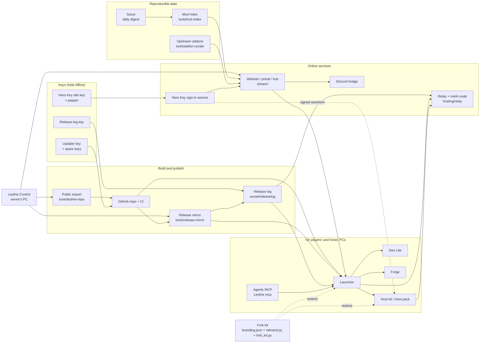

# The Leyline toolkit: every part as a tool anyone can run

Owner, 3 Nov 2026: "Segment features of this whole Leyline launcher into tools that anyone can use to recreate or
reskin this software to uphold the network no matter what."

This page splits Leyline into separate tools. For each one it says what the tool does, where its code is, what goes in
and comes out, how to run it on its own, its licence, what a fork changes and what it needs. How the network carries on
if the owner can't is in [SUCCESSION.md](SUCCESSION.md). Rebuilding under another name, step by step, is in
[FORKING.md](FORKING.md). What survives an outage is in [RESILIENCE.md](RESILIENCE.md).

Hard lines every tool and every fork keeps:
- no game data and no game client on any server or over P2P (players bring their own);
- no money, tips, tokens or mining;
- no decompiled clients;
- the game's and its maker's names never appear in player-facing text.

**Start with the fork check.** `python3 -I tools/fork-kit/fork_kit.py check [--online]` (Control step `fork-check`,
read-only) prints a checklist of what a copy still shares with Leyline and what it is missing. See tool 15 below.

## At a glance

| # | Tool | Code | Public today? | Licence |
|---|---|---|---|---|
| 1 | Launcher | `launcher/` | yes (Leyline repo) | MIT |
| 2 | Launcher releases and self-update | `launcher/src-tauri/src/update.rs`, `tools/github-workflows/leyline-launcher.yml` | yes | MIT |
| 3 | Release mirror | `tools/release-mirror/` | **no** (workspace only) | none stated |
| 4 | Release log ("the chain") | `hosting/kit/tools/wunet/releaselog.py`, `launcher/src-tauri/src/releaselog.rs` | yes | MIT |
| 5 | Mod index and daily updater | `tools/hub-index/`, `tools/addon-curate/`, `.github/workflows/{hub-index,scout}.yml` | **no** | none stated |
| 6 | Hero Key identity | `stream/herokeys.py`, `stream/herokey_sso.py`; the sign-in service itself | **no** (the issuing service is a separate project) | none stated |
| 7 | Hero Key for realms (the checking side) | `hosting/kit/tools/wunet/herokey.py`, `wuhost/agent.py` | yes | MIT |
| 8 | Relay and mesh node | `hosting/relay/`, `wunet/mesh.py` | yes | MIT |
| 9 | Host kit and Host pack | `hosting/kit/`, `hosting/pack/` | yes | MIT; realm images AGPL-3.0 (AzerothCore) |
| 10 | Den Lite | `labs/den-lite/` | built by CI, source in the workspace | MIT OR Apache-2.0 |
| 11 | Forge | `forge/` | release `forge-latest` (source tarball) | GPL-3.0 (from Noggit Red) |
| 12 | Website, portal and hub | `stream/` | **no** | none stated |
| 13 | Leyline Control | `tools/control/control.py` | **no** | none stated |
| 14 | Agents (MCP) and the community brain | `launcher/src-tauri/src/agents.rs`, `agents/den.rs`, `docs/leyline/agents.md` | yes | MIT |
| 15 | Fork kit | `launcher/branding.json`, `launcher/scripts/rebrand.py`, `tools/fork-kit/` | branding and rebrand yes; fork_kit **no** | MIT |
| 16 | Discord bridge and Discord setup | `hosting/discord/` (bridge), `tools/discord-leyline/` (server setup) | bridge yes, setup no | MIT / none stated |

"Public today" means the path is in the `ALLOW` list of `tools/leyline-repo/export.py`. Only those parts are in
`orionopenwow/Leyline`. Everything marked **no** exists only in the private workspace repo, so nobody else can
rebuild it until it is published. That is the biggest gap. See [SUCCESSION.md](SUCCESSION.md), decision D1.

## How the parts depend on each other

Read it this way:
- Everything a player installs comes from GitHub or a mirror, and is checked against keys built into the launcher (the
  updater key, and the release-log key once it exists). That is why the keys, not the servers, are what the network
  can least afford to lose.
- The website is the one service where losing it loses data. It holds the Hero Key sign-in, profiles, the forum and
  the approved mod lists.

---

## 1. Launcher

- **What it does:** the desktop app players use. It signs them in (Hero Key, Google), manages their own game folders,
  installs mods, lists Official and Community realms, opens Your Den, hosts realms and updates itself.
- **Code:** `launcher/` (Tauri 2). The UI is in `ui/` and the Rust core in `src-tauri/`. Addresses and the look come
  from `launcher/branding.json` (read at build time by `src-tauri/src/branding.rs`).
- **In / out:** in, the branding.json addresses (site, relays, flags, update sources). Out, an installer per platform
  plus `latest.json`.
- **Run alone:** `cd launcher && npm ci && npx tauri build`. Signing needs `TAURI_SIGNING_PRIVATE_KEY`. UI tests:
  `node --test tests/<file>.browser.test.cjs` (Playwright with a fake core). Rust tests:
  `cargo test --no-default-features --lib` in `src-tauri`.
- **Licence:** MIT (the Leyline repo's `LICENSE`).
- **A fork changes:** `launcher/branding.json` (name, identifier, colours, logo, site, repo, update sources, release
  key, relays, flags). Apply it with `launcher/scripts/rebrand.py`. Also change the updater key in
  `src-tauri/tauri.conf.json` and the logo files. `tools/fork-kit` lists anything still left over.
- **Needs:** an updater key, a place for releases (GitHub or a mirror), a relay, and a website for sign-in and the realm
  list. Without a website it still plays solo, Den and community realms through the mesh (`mesh_realms`).

## 2. Launcher releases and self-update

- **What it does:** builds and signs each release. The installed launcher then updates itself from GitHub, then from
  the mirrors in branding.json, then from the mirrors the release log names (`update.rs` `sources`). It never installs
  anything that the updater key or a spare key did not sign, and never installs an older or equal version.
- **Code:** `tools/github-workflows/leyline-launcher.yml` (CI in the public repo), `launcher/src-tauri/src/update.rs`,
  `launcher/scripts/release_version.py`.
- **In / out:** in, a push to the public repo. Out, a GitHub release `launcher-v<version>` with installers,
  `.sig` files and `latest.json`.
- **Run alone:** any PC: `npx tauri build` with the signing key set, then upload the files and `latest.json` to a
  release or to any static folder.
- **Licence:** MIT.
- **A fork changes:** `updates.*` in branding.json, its own updater key, and its own spare keys in
  `updates.backup_pubkeys`.
- **Needs:** the updater key. Today it exists only as a GitHub secret, and there is no spare yet.

## 3. Release mirror

- **What it does:** copies the newest launcher releases, the Host pack, the Leyline addons and the pinned upstream
  server source to a static folder, with sha256, torrents and a `latest.json` that points at the mirror. When the
  release key is present it also signs one release-log entry per item.
- **Code:** `tools/release-mirror/release_mirror.py` (Control steps `release-mirror`, `release-mirror-check`).
- **In / out:** in, the public GitHub releases and `hosting/kit/profiles/*/profile.lock`. Out, `index.json`,
  `SHA256SUMS`, `.torrent` files, `latest.json` and `chain.json` in a folder, uploaded over SSH.
- **Run alone:** `python3 -I tools/release-mirror/release_mirror.py build --out DIR`, then serve DIR with any web
  server. `check` is read-only. Tests: `tools/release-mirror/test_release_mirror.py`.
- **Licence:** none stated (workspace only).
- **A fork changes:** the server address and the repo it reads (read from branding.json, `branding()`).
- **Needs:** network access to GitHub, and SSH for `upload`. Gaps: it cannot yet copy from a local build folder
  without GitHub, and each community mirror needs its own `latest.json` (RESILIENCE.md, "What is not done yet").

## 4. Release log ("the chain")

- **What it does:** an append-only, hash-linked list of every release, Host pack, addons pack and pinned source
  tarball (files, sizes, sha256, mirrors), each entry signed with one Ed25519 key. Launchers, relays and host agents
  keep copies and swap them. The longest valid chain wins.
- **Code:** `hosting/kit/tools/wunet/releaselog.py` (with a CLI), `launcher/src-tauri/src/releaselog.rs`, and the relay's
  `/api/mesh/chain`.
- **In / out:** in, files and the release key. Out, `chain.json`.
- **Run alone:** `PYTHONPATH=hosting/kit/tools python3 -m wunet.releaselog keygen|public|append|verify`.
- **Licence:** MIT.
- **A fork changes:** `release_log.public_key` and `release_log.urls`, and its own key.
- **Needs:** the release key. **It has not been made yet**, so the chain is dormant. The format has one key and no
  rotation; the plan to add rotation is in SUCCESSION.md.

## 5. Mod index and daily updater

- **What it does:** three linked jobs.
  - The **scout** finds new open projects every day.
  - The **index** (`hub_index.py`) probes every candidate (licence, game-format files, binaries, paid, decompiled,
    brand words, supported build) and writes a link-out catalog. Nothing is hosted.
  - **addon-curate** pins each upstream addon to an exact file and sha256 for the launcher's one-click install.
  Machines add and refresh. Only a person approves.
- **Code:** `tools/hub-index/` (`hub_index.py`, `scout.py`, `seeds.json`, `candidates.json`, `blocklist.json`,
  `external-packs.json`), `tools/addon-curate/` (`curate.py`, `seeds-addons.json`), and the workflows `hub-index.yml`
  and `scout.yml`. The plan is in `docs/MODS-DAILY.md` and `docs/HUB-INDEX.md`.
- **In / out:**
  - in: the seed, candidate and blocklist JSON, and the forges' public APIs (a GitHub token is optional);
  - out: `stream/hub/community-index.json`, `tools/hub-index/holding.json`, `mods/upstream.json`, then (after
    approval) `stream/upstream-addons.json`, and `docs/scout/<date>.md`.
- **Run alone:** `python3 -I tools/hub-index/hub_index.py build`, `... scout.py run`,
  `python3 -I tools/addon-curate/curate.py run`. Control step `mods-daily`. Tests: `tools/hub-index/test_*.py`,
  `tools/addon-curate/test_curate.py`.
- **Reproducible:** `build` writes "same input, same bytes" (sorted, no dates of its own). Any mirror that runs it on
  the same seeds and the same day's upstream state gets the same index, and can compare its sha256 with ours.
- **Licence:** none stated. The listed projects keep their own licences. The index only links to them.
- **A fork changes:** nothing to run it. To publish it, the address where the site serves the index and the approver
  names (`curate.py approve --by`).
- **Needs:** git, and network access to the forges. The approval step is the Admin Console (website) or
  `curate.py approve`.

## 6. Hero Key identity (issuing)

- **What it does:** one sign-in for the website, the launcher and community realms.
  - A Hero Key is `ovk1.<id>.<secret>`. The sign-in service keeps only the id and a SHA-256 of the secret.
  - The portal's Hero Key page (`stream/herokeys.py`) asks that service for the player.
  - `stream/herokey_sso.py` signs per-realm assertions with the site key (Ed25519, context
    `leyline-herokey-sso-v1`). Each one carries a per-realm pseudonym (an HMAC under the site's pepper) and an SRP
    verifier for a one-time password.
- **Code:** `stream/herokeys.py`, `stream/herokey_sso.py`, `stream/social.py` (the launcher's token). The issuing
  sign-in service (the Rust site on the server, `PORTAL_URL`) is **a separate project, not in this repo**
  (`docs/leyline/hero-key.md`).
- **In / out:** in, a key, a password or Google. Out, a website session, a revocable launcher token, and signed realm
  assertions. `GET /wrath/leyline/herokey.json` publishes the site's public keys.
- **How a second site could accept the same keys:**
  1. Copy the service's key table: id and SHA-256 of the secret, never the secrets, which nobody has. With it, any
     site checks a presented key by hashing it. Players keep the keys they already hold.
  2. Copy the pepper. Without it, every player's per-realm pseudonym changes: their realm characters stay on the old
     accounts and are cut off.
  3. Either reuse the site key, or (better) make a new one and get realm hosts to pin it beside the old one. `SITE_KEYS`
     is already a list, and `setup.py herokey pin` adds one.
  The table, the pepper and the site key are all in the server backup (`/srv/wrath/portal-data/`, RESILIENCE.md
  step 4).
- **How a second site could run its own:**
  1. Run the portal with its own sign-in service, site key and pepper.
  2. Realm hosts pin its key too. The agent accepts any pinned key, and each assertion names its key (`kid`).
  3. Players get new keys there. Their accounts on realms are new (a different `sub`) unless the realm links them by
     hand.
- **Licence:** none stated (workspace only).
- **A fork changes:** the issuer name (`iss`), the site key, the pepper and the address of `herokey.json`.
- **Needs:** the website and the sign-in service. **This is the network's identity, and today it lives on one server.**

## 7. Hero Key for realms (checking)

- **What it does:** a community realm's agent checks a site-signed assertion (signature, audience, expiry, nonce),
  then makes or updates an `HK...` account. The game client logs in as usual. Off by default, opt-in per realm.
- **Code:** `hosting/kit/tools/wunet/herokey.py`, `wuhost/agent.py` (`herokey_login`), `wuhost/coredb.py`,
  `wuhost/hktest.py`. The relay route is `/api/realms/<id>/herokey`.
- **In / out:** in, an assertion and its signature. Out, a game account with a short-lived verifier.
- **Run alone:** `setup.py herokey on|off|pin`. Tests: `hosting/tests/test_herokey_sso.py`.
- **Licence:** MIT.
- **A fork changes:** `SITE_KEYS` (or `WU_HEROKEY_SITE_KEYS`) to its own site's public key.
- **Needs:** a pinned site key. Today none is pinned, because the `herokey_sso` flag is off.

## 8. Relay and mesh node

- **What it does:**
  - lets a home-hosted realm be reached with no open ports and the host's IP hidden;
  - serves join pages, the realm listing and the Hero Key redeem route;
  - with `RELAY_MESH=1`, gossips signed realm records and the release log with other nodes.
  Anyone can run a volunteer relay.
- **Code:** `hosting/relay/` (`wurelay/`, `Dockerfile`, `deploy/`), `hosting/kit/tools/wunet/mesh.py`,
  `hosting/kit/docker-compose.volunteer-relay.yml`. The design is in `docs/LEYLINE-MESH.md`, and how to run a node is in
  `docs/leyline/be-a-node.md`.
- **In / out:** in, agents (outbound WSS), players (TCP and WebSocket) and peer nodes. Out, `/api/listing/*`,
  `/api/mesh/*` and `/healthz`.
- **Run alone:** Docker (`hosting/relay/Dockerfile`), or the volunteer compose file. Tests: `hosting/tests/`.
- **Licence:** MIT.
- **A fork changes:** `relays` in branding.json (the first is the seed every launcher asks). `rebrand.py` writes
  `p2p::mesh::SEEDS`.
- **Needs:** a public name with TLS. Note that today's two seed relay names are on the same server.

## 9. Host kit and Host pack

- **What it does:** one click to host a realm for any supported client. It builds the server software from its authors'
  source at pinned commits, and extracts game files from the host's own client on the host's own PC. It can also link
  an existing server (`join-network`). The Host pack is the same kit as a checked download the launcher fetches.
- **Code:** `hosting/kit/` (`leyline` command, `profiles/*/profile.lock`, `tools/wuhost`, `tools/wunet`),
  `hosting/pack/make-hostpack.py`. The guides are `docs/HOST-PACK.md`, `docs/HOST-ANY-CLIENT.md` and
  `docs/leyline/hosting.md`.
- **In / out:** in, the host's own client and Docker. Out, a running realm linked to a relay.
- **Run alone:** `hosting/kit/host-wrath-realm.sh` or `Host a Leyline realm.bat`. Control steps `hostkit` and the
  Host pack release.
- **Licence:** MIT for our code. The realm images are AzerothCore (AGPL-3.0), and the other profiles build CMaNGOS and
  TrinityCore (GPL-2.0) from source.
- **A fork changes:** the relay it dials, the image registry (`WU_IMAGE`) and the pinned website key.
- **Needs:** upstream source (the release mirror keeps copies at our pins), Docker and a relay.

## 10. Den Lite

- **What it does:** a tiny local server for one player's private building world (Your Den). It needs no Docker and no
  database. It reads the same Den files as the full Den.
- **Code:** `labs/den-lite/` (its own crate). CI is `den-lite.yml`, which publishes the release `den-lite-latest`. The
  launcher downloads it on the first Play solo (`host/lite.rs`).
- **Run alone:** `cargo build --release`, then `den-lite --dens <folder> --bind 127.0.0.1`.
- **Licence:** MIT OR Apache-2.0.
- **A fork changes:** the release it is downloaded from (the repo in branding.json).
- **Needs:** nothing online.

## 11. Forge

- **What it does:** the Den's ground editor (Windows). The launcher starts `Forge.exe`.
- **Code:** `forge/` (from Noggit Red). CI is `forge.yml`, which publishes the release `forge-latest` (`Forge.zip` and
  a source tarball, as the GPL requires).
- **Licence:** GPL-3.0. A fork must keep publishing the source with every build.
- **A fork changes:** the name in its window, if it wants, and where the release is published.
- **Needs:** a Windows CI runner.

## 12. Website, portal and hub

- **What it does:** leylinelauncher.com:
  - the front page and hub, and the realm list;
  - sign-in pages and Hero Key;
  - profiles, social, forum and Workshop;
  - the flags file (`/wrath/leyline/flags.json`) and the release mirror's address;
  - Leyline HQ (`/wrath/admin`), where the owner approves mods and flags.
- **Code:** `stream/` (`wrath_portal.py` and its modules), served behind Caddy (`server/Caddyfile`). It is deployed by
  the `signin` step (`stream/fastloop.sh`).
- **Run alone:** `python3 stream/wrath_portal.py` with the variables listed at the top of the file. Tests:
  `stream/tests/test_*.py stream/wrath_portal.py`.
- **Licence:** none stated (workspace only).
- **A fork changes:** the host names, the brand switch (`LEYLINE_BRAND`), the sign-in service address
  (`PORTAL_URL`) and the art.
- **Needs:** the sign-in service (tool 6), SQLite files in `portal-data/` and the realm's SOAP for game accounts.
  **The player data here (accounts, forum, profiles) exists only on the server and in its backups.**

## 13. Leyline Control

- **What it does:** the owner's local panel. It runs named steps (`.bat` files) from a queue, with Autopilot, logs and
  a `READ_ONLY` set that may run unattended. It is how changes reach GitHub, the server and the public repos.
- **Code:** `tools/control/control.py` (`STEPS`, about 100 entries), `UPDATE.bat`, `UPDATES-PENDING.txt`.
- **Run alone:** `py -3 tools\control\control.py` on Windows. Every step is also a plain `.bat` or script that runs
  without Control. Tests: `tools/control/test_*.py`.
- **The fresh computer test:** `tools/first-run/Fresh computer test.bat` (steps `fresh-test`, `fresh-sandbox`): every
  feature from an empty profile or a Windows Sandbox, PASS / FAIL per check (docs/FRESH-COMPUTER-TEST.md).
- **Licence:** none stated (workspace only).
- **A fork changes:** the server address and SSH key the deploy steps use. A community would more likely move the steps
  into CI with a deploy key than run one person's PC.
- **Needs:** SSH to the server, and GitHub credentials for `ship`. **These are the owner's alone today.**

## 14. Agents (MCP) and the community brain

- **What it does:** `Leyline mcp` runs a local MCP server (stdin and stdout, no network port) for the player's own
  assistant (Claude Code, the Claude desktop app, any MCP client). It has three tiers:
  - **read:** realm status, realm list, mods, the player's realm logs (scrubbed) and the Den;
  - **ask:** every call shows an approval card in the launcher;
  - **never:** sign-in, money, deletes, realm visibility, bans, updates. These have no tool at all.
  The Den tools add a companion and a **building library** of recipes (`launcher/src-tauri/den-recipes/`,
  `state/dens/recipes/`) that grows as people share recipe files.
- **The community brain** is the knowledge that lets anyone, with or without an assistant, create and run servers:
  - the public guides (`docs/leyline/`, served at `/wrath/docs`);
  - the recipe library;
  - the scout digests (`docs/scout/`);
  - the bug manifest (`docs/BUGS-MANIFEST.md`);
  - the host kit's own checks (`Check my realm`, `hktest`).
  None of it depends on one person's Claude account. The recipes and guides are files anyone can copy.
- **Code:** `launcher/src-tauri/src/agents.rs`, `agents/den.rs`, `ui/agents.js`, `docs/leyline/agents.md`, and
  `docs/DEN.md` ("Building brain").
- **Run alone:** `Leyline mcp` (the launcher binary with the argument `mcp`). In the launcher, Agents > Add for me.
- **Licence:** MIT.
- **A fork changes:** nothing but the name.
- **Proposed next step (not built):** "operator" tools for realm hosts and relay operators. These would be read tools
  for relay health, mirror freshness and chain head, and ask tools for a kit update or a realm restart, in the same
  three tiers. They would let any host's assistant help keep the network up, not only the owner's.

## 15. Fork kit

- **What it does:** reskins and re-points everything from one file. It also checks that a copy is ready to run on its
  own.
- **Code:**
  - `launcher/branding.json` (the one file);
  - `launcher/scripts/rebrand.py` (applies it: addresses, colours, name, seed relays and the release key);
  - `docs/FORKING.md` (keys, build, publish);
  - **`tools/fork-kit/fork_kit.py`** (the readiness check, new);
  - the Control step `fork-check` (read-only).
- **What `fork_kit.py check` reports:**
  - branding.json valid by rebrand.py's own rules, and the logo files present;
  - for a fork, its own app identifier and its own updater key (Leyline's key id is known), and no Leyline addresses
    left in the launcher;
  - brand words in player-facing files, using the public export's own checker (`export.py`'s file set,
    `user_facing()` and its word list) plus all of `launcher/ui`, with the legal disclaimer line allowed;
  - GitHub plus mirrors, and spare updater keys that are well formed;
  - the release-log key set, the same in the host kit, published in two or more places (and `--chain FILE` verified);
  - two or more relays on different domains;
  - Hero Key pins;
  - `--online`: every source, mirror, chain address, relay `/healthz` and the flags file fetched.
  It exits with 1 when any line is FAIL. Tests: `tools/fork-kit/test_fork_kit.py`.
- **Licence:** MIT for branding and rebrand. The fork kit has none stated yet (workspace only).

## 16. Discord bridge and Discord setup

- **What it does:**
  - The **bridge** (`hosting/discord/wudiscord/bridge.py`) carries the realm's World chat to and from one Discord
    channel, plus a bug feed. It talks to the realm over SOAP and uses the Discord bot token from the environment.
  - The **setup** (`tools/discord-leyline/`) lays out the server's channels and roles once, from the owner's PC, after a
    preview and a typed YES.
- **Run alone:** `PYTHONPATH=hosting/discord python3 -m wudiscord.bridge --check`, and then without `--check`.
- **Licence:** the bridge is MIT (public). The setup has none stated.
- **A fork changes:** its own bot, server and channel ids. Nothing in the code names our server.
- **Needs:** a Discord server, which belongs to whoever owns it. See SUCCESSION.md.

---

## What a community needs to rebuild everything

| To run | It needs | Have it today? |
|---|---|---|
| The launcher, updates, mirrors | the public repo, an updater key (or a spare), any static host | repo yes; **no spare key** |
| Realms, relays, Hero Key on realms | the public repo, Docker, a domain with TLS | yes |
| The mod index and daily updates | `tools/hub-index`, `tools/addon-curate`, the seed files | **private only** |
| The website, sign-in, forum, profiles | `stream/`, the sign-in service, the server's data | **private only; the sign-in service is a separate project** |
| The same players' Hero Keys | the key table, pepper and site key from the server backup | **only if the backup exists and someone can reach it** |
| Signed history of what was released | the release key | **not made yet** |

The plan for closing these gaps, and who decides, is in [SUCCESSION.md](SUCCESSION.md).
